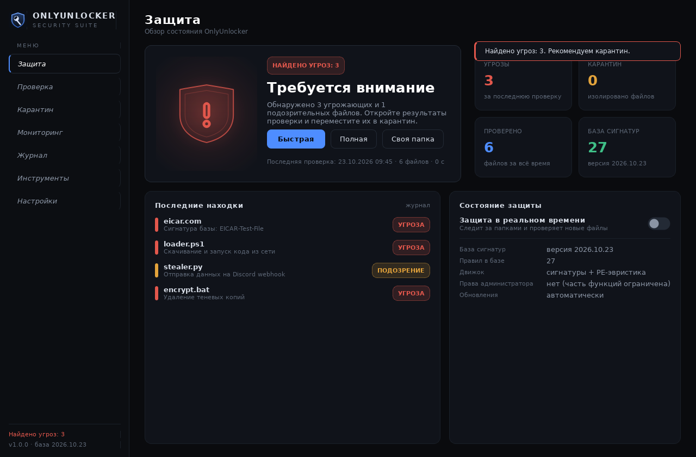
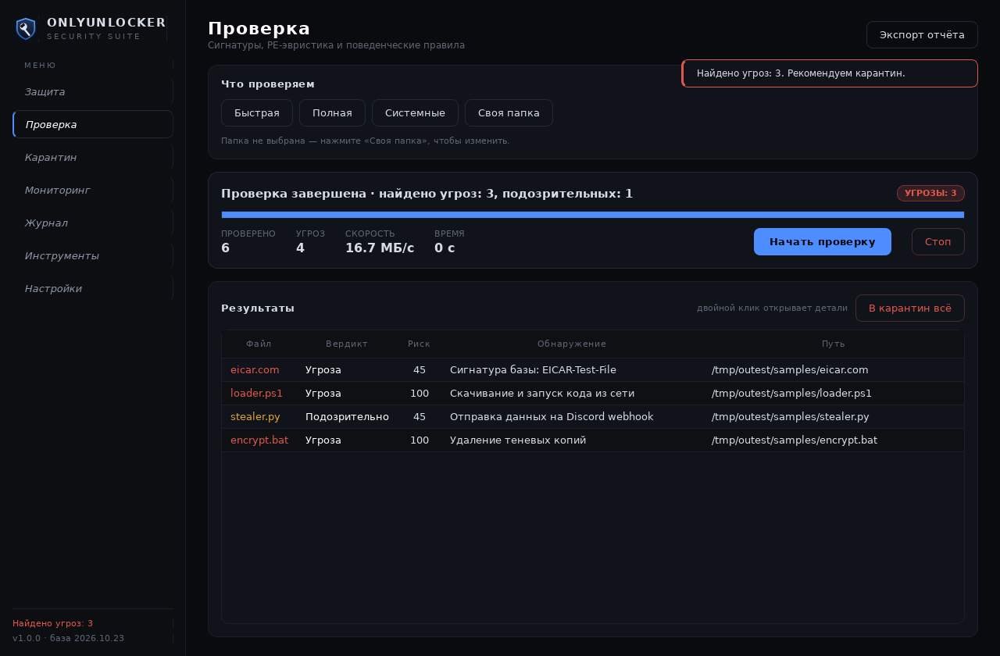
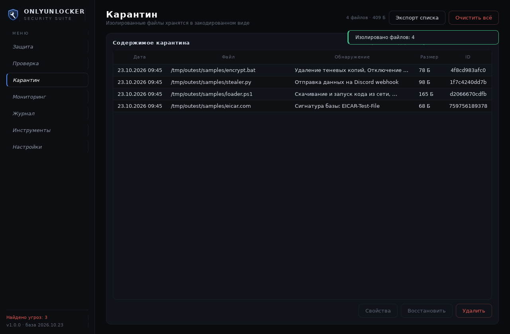
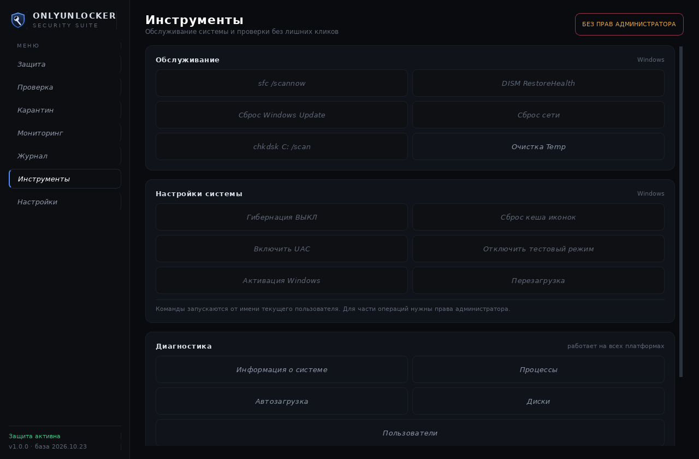
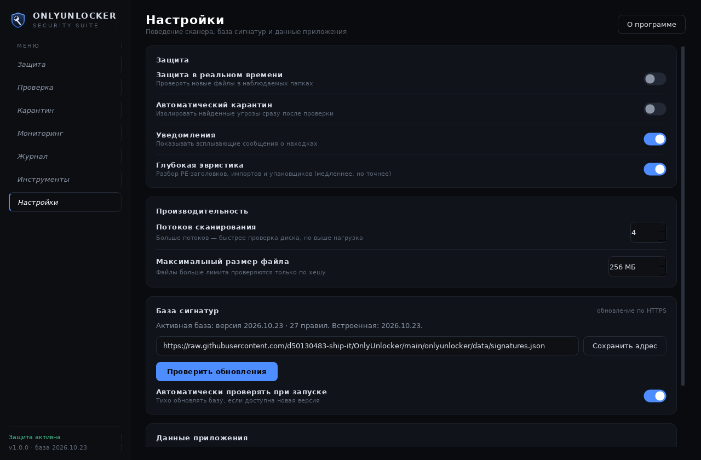
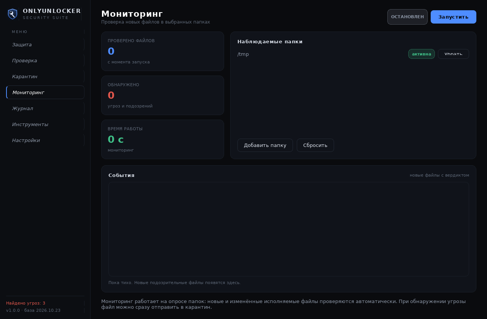
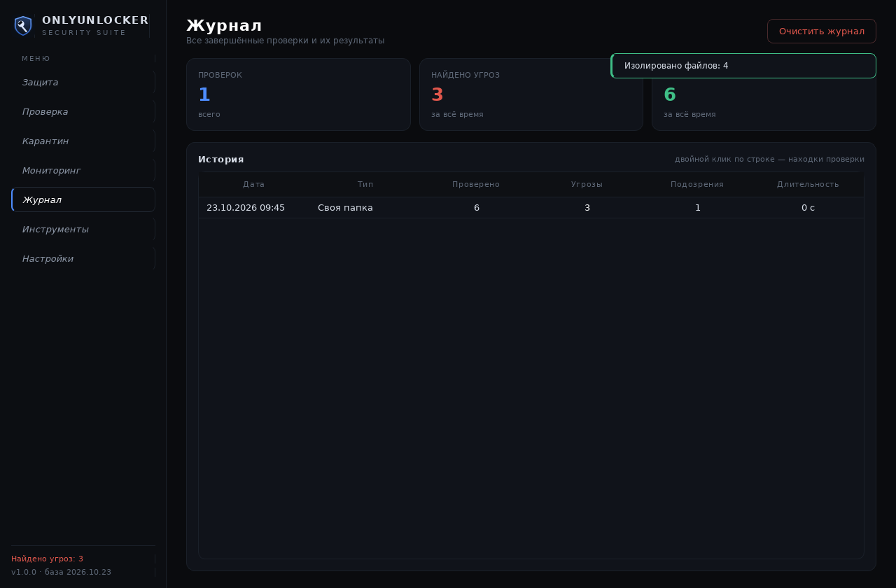
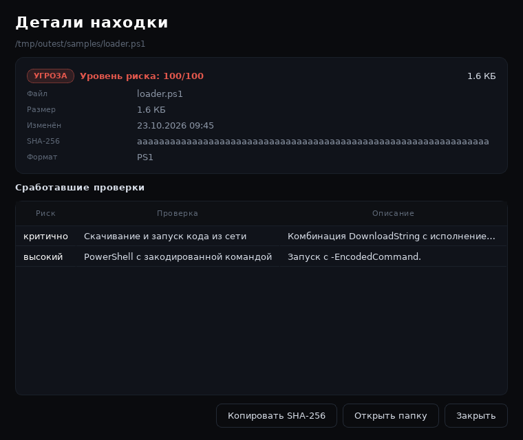

# OnlyUnlocker

**Антивирусный сканер на Python с тёмным интерфейсом в стиле RATNIK.**
Сигнатуры + PE-эвристика + карантин + мониторинг в реальном времени + блок системных инструментов.

<p align="center">
  
</p>

---

## Возможности

**Сканер**
- **Хеш-сигнатуры** SHA-256 (совпадение = мгновенный вердикт «угроза»).
- **Байтовые шаблоны с масками** — `4D 5A ?? 00`, `*12` (до 12 произвольных байт).
- **Текстовые правила для скриптов** — PowerShell-обфускация, download cradle, обход AMSI, удаление теневых копий, webhook-эксфильтрация, обратные шеллы, майнеры и т. д.
- **Разбор PE без внешних библиотек**: заголовки, секции и их энтропия, точка входа, импорты, оверлей, цифровая подпись, .NET, Rich-заголовок, определение упаковщиков (UPX, VMProtect, Themida, ASPack, MPRESS…).
- **Поведенческие эвристики**: цепочки импортов для инъекций, доступ к LSASS, RWX-секции, PE без импортов, вложенный PE в оверлее, подмена системных имён, двойные расширения, подозрительные LNK и др.
- Итоговый **балл риска 0–100** и объяснение каждой находки: какая проверка сработала и почему.
- Многопоточность, отмена, расширения-фильтры, пропуск мусорных каталогов, лимиты по размеру файла.

**Защита**
- **Карантин**: файл изолируется из системы, хранится закодированным уникальным ключом машины; восстановление и удаление из интерфейса.
- **Мониторинг в реальном времени**: следит за папками и проверяет новые/изменённые исполняемые файлы.
- **Журнал** всех проверок с экспортом отчёта в JSON.
- **Обновление базы сигнатур** по HTTPS (GitHub raw или любой свой URL).
- **Автоматический карантин** находок сразу после проверки (настройка).

**Инструменты**
- `sfc /scannow`, `DISM /RestoreHealth`, сброс Windows Update и сети, `chkdsk`, очистка Temp.
- Гибернация, кеш иконок, включение UAC, отключение тестового режима, перезагрузка / перезагрузка в WinRE.
- Диагностика: процессы, автозагрузка, диски, пользователи, сведения о системе.
- Быстрая проверка **файлов запущенных процессов** и **программ из автозагрузки** в один клик.

---

## Скриншоты

| Проверка | Карантин |
|---|---|
|  |  |

| Инструменты | Настройки |
|---|---|
|  |  |

| Мониторинг | Журнал |
|---|---|
|  |  |

Детали находки:



---

## Установка и запуск

Нужен **Python 3.10+**.

### Windows

1. Скачайте папку проекта и откройте её.
2. Двойной клик по **`start_windows.bat`** — при первом запуске зависимости установятся сами.
3. Либо вручную:

```bat
python -m pip install -r requirements.txt
python run.py
```

Сборка в один `OnlyUnlocker.exe` (иконка и база сигнатур внутри):

```bat
build_windows.bat
:: результат: dist\OnlyUnlocker.exe
```

### Linux / macOS

```bash
python3 -m pip install -r requirements.txt
./OnlyUnlocker.sh
# или
python3 run.py
```

### Консольный режим (без GUI)

```bash
python run.py info                      # информация о базе
python run.py scan C:\Users\me\Downloads # проверка папки
python run.py scan --full --quarantine  # полная проверка + карантин находок
python run.py scan file.exe --json      # машинночитаемый отчёт
python run.py quarantine list           # содержимое карантина
python run.py quarantine restore <id>   # восстановить файл
python run.py update                    # обновить базу сигнатур
```

`scan` возвращает код `1`, если найдены угрозы, — удобно для CI и скриптов.

---

## Горячие клавиши

`Ctrl+1`…`Ctrl+7` — переключение между разделами (Защита, Проверка, Карантин, Мониторинг, Журнал, Инструменты, Настройки).

---

## Как это устроено

```
onlyunlocker/
├─ core/
│  ├─ scanner.py      # обход файлов, потоки, вердикты, отмена
│  ├─ heuristics.py   # независимые правила-эвристики над контекстом файла
│  ├─ pe.py           # собственный разбор PE: секции, импорты, оверлей, упаковщики
│  ├─ signatures.py   # загрузка базы: хеши, байтовые маски, regex-правила
│  ├─ quarantine.py   # изоляция/восстановление файлов
│  ├─ monitor.py      # мониторинг папок в реальном времени
│  ├─ storage.py      # настройки (JSON) и журнал проверок (JSONL)
│  ├─ updater.py      # загрузка базы по HTTPS с валидацией
│  ├─ system_tools.py # процессы, автозагрузка, диски, пользователи
│  ├─ models.py       # Verdict, Detection, FileReport, ScanSummary
│  └─ cli.py          # консольный интерфейс
├─ ui/
│  ├─ main_window.py  # каркас: сайдбар, стек страниц, тосты
│  ├─ theme.py        # палитра и глобальный QSS
│  ├─ widgets.py      # карточки, щит с анимацией, переключатели, бейджи
│  ├─ dialogs.py      # детали находки, таблицы, терминал команд
│  ├─ workers.py      # QThread-сканер и запуск процессов
│  └─ pages/          # 7 страниц интерфейса
└─ data/signatures.json
```

Вердикт:

| Балл риска | Вердикт |
|---|---|
| ≥ 70, либо сигнатура/паттерн, либо критическая проверка | **Угроза** |
| 30–69 | **Подозрительно** |
| < 30 | **Чисто** |

Срабатывания складываются из весов: `low 10`, `medium 25`, `high 45`, `critical 80` (максимум 100).

---

## Свои сигнатуры

База — обычный JSON: `onlyunlocker/data/signatures.json`. Свою версию можно положить в
`%LOCALAPPDATA%\OnlyUnlocker\signatures.json` (Linux: `~/.local/share/OnlyUnlocker/`) или
обновить из интерфейса. Подробный формат — в [docs/SIGNATURES.md](docs/SIGNATURES.md).

Пример правила:

```json
{
  "name": "Script.Cmd.Taskkill.Antivirus",
  "title": "Отключение антивируса",
  "regex": "taskkill[^\\n]{0,120}(?:msmpeng|avp|kav|defender)",
  "extensions": [".bat", ".cmd", ".ps1"],
  "severity": "high",
  "family": "DefenseEvasion"
}
```

---

## Тесты

```bash
python -m pytest tests -q
```

Тесты покрывают сигнатуры, маски, разбор PE (на синтетическом PE), эвристики, карантин,
журнал, отмену скана и утилиты. EICAR-файл в тестах создаётся во временном каталоге.

---

## Приватность

Всё локально: программа не отправляет файлы на серверы, не собирает телеметрию.
Единственный сетевой запрос — загрузка базы сигнатур по адресу, который вы указали
(по умолчанию — raw-файл этого репозитория).

---

## Ограничения и честная оговорка

- Это **не замена** Windows Defender или коммерческому антивирусу: нет облачной репутации,
  драйвера фильтрации ФС, песочницы и поведенческого перехвата в ядре.
- Эвристика может давать ложные срабатывания на упакованных, самописных или
  «крякнутых» программах — поэтому всегда показывается причина и балл риска.
- Инструменты вроде «отключить тестовый режим» или «перезагрузка» выполняются с правами
  текущего пользователя; часть из них требует прав администратора.
- Используйте проект для защиты **своих** компьютеров и в учебных целях. Сигнатуры в базе
  описывают классы угроз, а не конкретные приватные образцы.

---

## Лицензия

MIT — см. [LICENSE](LICENSE).
